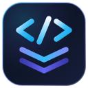
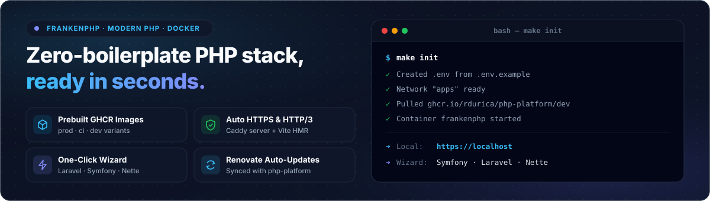
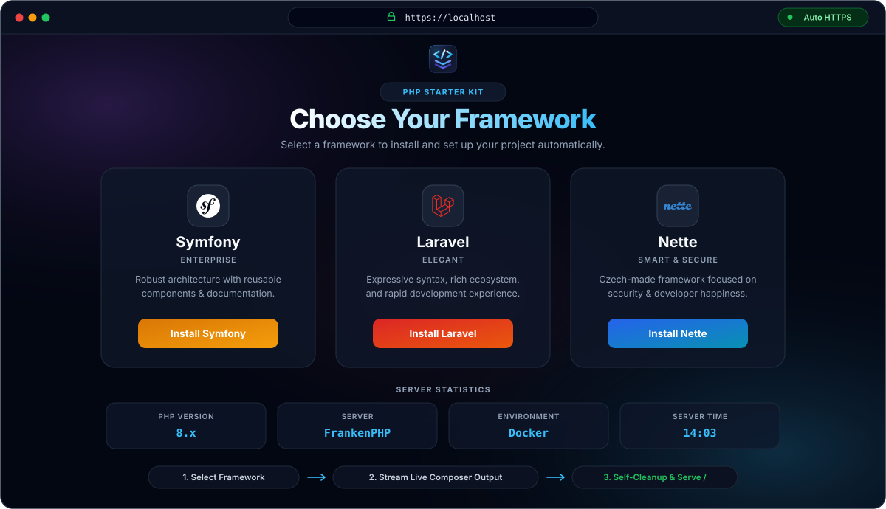
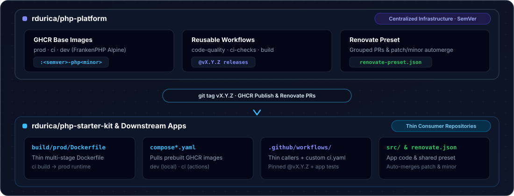

<p align="center">
  
</p>

<h1 align="center">PHP Starter Kit</h1>

<p align="center">
  Lightweight Docker-based template for modern PHP applications built on <strong>FrankenPHP</strong> — powered by shared base images and reusable workflows from <a href="https://github.com/rdurica/php-platform"><strong>rdurica/php-platform</strong></a>.
</p>

<p align="center">
  <a href="https://www.php.net/"></a>
  <a href="https://frankenphp.dev/"></a>
  <a href="https://github.com/rdurica/php-platform"></a>
  <a href="https://github.com/rdurica/php-starter-kit/actions/workflows/ci.yaml"></a>
  <a href="https://github.com/rdurica/php-starter-kit/actions/workflows/code-quality.yml"></a>
  <a href="LICENSE"></a>
</p>

<p align="center">
  <a href="#quick-start">Quick Start</a> &nbsp;·&nbsp;
  <a href="#key-features">Features</a> &nbsp;·&nbsp;
  <a href="#framework-installation">Setup Wizard</a> &nbsp;·&nbsp;
  <a href="#architecture--platform-updates">Architecture</a> &nbsp;·&nbsp;
  <a href="#available-commands">Commands</a> &nbsp;·&nbsp;
  <a href="#environments">Environments</a> &nbsp;·&nbsp;
  <a href="#cicd">CI/CD</a>
</p>

<p align="center">
  <picture>
    <source media="(prefers-color-scheme: dark)" srcset="docs/img/banner-dark.svg">
    <source media="(prefers-color-scheme: light)" srcset="docs/img/banner-light.svg">
    
  </picture>
</p>

---

## Quick Start

1. Click **Use this template** on GitHub to create your repository. On the first push to `main`, [template-setup.yml](.github/workflows/template-setup.yml) automatically updates project placeholders across `.env.example`, `.devcontainer/devcontainer.json`, `src/public/index.php`, `README.md`, and `AGENTS.md`, then cleans up its setup scripts.
2. Clone your repository and initialize the Docker environment:

```bash
git clone https://github.com/rdurica/php-starter-kit.git && cd php-starter-kit && make init
```

3. Open [https://localhost](https://localhost) and select your framework in the interactive Setup Wizard.

> [!TIP]
> Run `make trust-cert` to install Caddy's local root CA certificate into your system trust store (auto-configured on Debian/Ubuntu and Fedora/RHEL; prints manual instructions for `/tmp/caddy-root.crt` on other systems).

---

## Key Features

- **Centralized base images (`php-platform`)** — Pulls prebuilt FrankenPHP 1.12 / PHP 8.5 Alpine images (`dev`, `ci`, `prod`) directly from GHCR with zero local base-image builds.
- **Automated platform updates** — Preconfigured [renovate.json](renovate.json) extending `github>rdurica/php-platform//renovate-preset` (grouped PRs with auto-merge for patch/minor/digest updates when CI passes; manual review for major bumps).
- **Hardened production runtime** — Non-root `robbyte` user (UID 1000), `expose_php = Off`, OPcache (`256M`) + tracing JIT (`128M`), Caddy `admin off`, security headers (`X-Frame-Options`, `X-Content-Type-Options`, `Referrer-Policy`, `Permissions-Policy`), Zstd/Brotli/Gzip compression, `/up` healthcheck, and entrypoint database/Redis wait with Laravel/Symfony auto-migrations.
- **Frontend & Vite HMR ready** — Node.js/npm preinstalled in the `dev` image; `npm run dev` starts automatically when `src/node_modules` exists, with Caddy proxying Vite assets and WebSocket HMR (`localhost:5173`).
- **One-click framework installer** — Browser-based setup wizard with real-time Composer streaming for Symfony, Laravel, and Nette.
- **IDE & DevContainer ready** — Includes [.devcontainer/devcontainer.json](.devcontainer/devcontainer.json) and [.vscode/](.vscode) presets with Xdebug 3 (`port 9003`, `PHPSTORM`), recommended extensions, and `make down` on folder close.
- **Customizable CI/CD** — Shared reusable workflows for code quality, Compose/Hadolint checks, and GHCR production builds with Trivy scanning, alongside an editable [ci.yaml](.github/workflows/ci.yaml) for application tests.

---

## Framework Installation

After running `make init`, visit [https://localhost](https://localhost) to launch the Setup Wizard:

<p align="center">
  
</p>

| Framework | Package | Description |
| --- | --- | --- |
| **Symfony** | `symfony/skeleton` | Robust architecture with reusable components and solid documentation |
| **Laravel** | `laravel/laravel` | Expressive syntax, rich ecosystem, and rapid development experience |
| **Nette** | `nette/web-project` | Czech-made framework focused on security and developer happiness (`www/` → `public/` handled automatically) |

Clicking **Install** and confirming triggers an automated workflow:

1. Downloads and installs the selected framework via Composer in an isolated temporary directory
2. Streams live installation progress and terminal output via Server-Sent Events (SSE)
3. Moves all generated files into `src/` (automatically relocating Nette's `www/` into `public/`)
4. Removes itself once the framework's own `public/index.php` takes over at `/`

> [!NOTE]
> Once your framework is installed, the repository is completely yours — replace this `README.md` and the assets in `docs/img/` with your application's documentation.

---

## Architecture & Platform Updates

Infrastructure (base Dockerfiles, Caddyfile, PHP INI, OPcache/JIT, entrypoints, and reusable GitHub workflows) is maintained centrally in **[rdurica/php-platform](https://github.com/rdurica/php-platform)** instead of being duplicated across application repositories:

<p align="center">
  <picture>
    <source media="(prefers-color-scheme: dark)" srcset="docs/img/architecture-dark.svg">
    <source media="(prefers-color-scheme: light)" srcset="docs/img/architecture-light.svg">
    
  </picture>
</p>

| Responsibility | Where it lives | How updates propagate |
| --- | --- | --- |
| PHP / FrankenPHP runtime, extensions, Caddy, OPcache/JIT, entrypoints | [php-platform](https://github.com/rdurica/php-platform) | Renovate PR bumps `:1.x.y-php8.5` tags in `Dockerfile` & `compose*.yaml` |
| Code quality, CI checks (Compose + Hadolint), and production Docker build workflows | [php-platform](https://github.com/rdurica/php-platform) | Renovate PR bumps `@v1.x.y` in caller workflows |
| Framework tests & app-specific CI steps | [.github/workflows/ci.yaml](.github/workflows/ci.yaml) | Fully editable per application |
| Application code & dependencies (`src/`) | This repository | Owned by the application |

> [!NOTE]
> **Explicit PHP minor version pinning:** The `-php8.5` image tag suffix keeps platform updates (`1.1.0` → `1.1.1`) automatic while preventing unintentional PHP upgrades. To adopt a newer PHP minor branch (e.g., `8.5` → `8.6`), explicitly change `-php8.5` to `-php8.6` in [build/prod/Dockerfile](build/prod/Dockerfile), [compose.yaml](compose.yaml), and [compose.ci.yaml](compose.ci.yaml).

---

## Project Structure

```text
.
├── .devcontainer/
│   └── devcontainer.json       # VS Code DevContainer configuration (robbyte user)
├── .githooks/
│   └── pre-commit              # Runs npx lint-staged locally or inside frankenphp
├── .github/
│   └── workflows/
│       ├── build.yaml          # Production image build, GHCR push & Trivy scan
│       ├── ci.yaml             # Reusable CI checks + customizable Framework Tests
│       ├── code-quality.yml    # Compose, frontend lint/typecheck, PHPStan/CS Fixer
│       └── template-setup.yml  # One-time template placeholder rename on first push
├── .vscode/                    # Xdebug launch config, tasks, and extension picks
├── build/
│   └── prod/
│       └── Dockerfile          # Thin multi-stage production image (ci → prod)
├── docs/
│   ├── README.md               # Documentation index
│   └── img/                    # Project brand assets and diagrams
├── src/
│   └── public/
│       └── index.php           # Interactive Setup Wizard (self-removes after install)
├── .env.example                # Compose project isolation and APP_NAME defaults
├── AGENTS.md                   # AI agent instructions for local container workflow
├── compose.yaml                # Local development stack (dev image + auto HTTPS)
├── compose.ci.yaml             # Lightweight CI testing stack (SQLite in-memory)
├── makefile                    # Convenience wrappers for Docker, hooks, and certs
└── renovate.json               # Inherits rdurica/php-platform//renovate-preset
```

---

## Requirements

- [Docker](https://docs.docker.com/get-docker/) & Docker Compose
- [Make](https://www.gnu.org/software/make/) (optional, recommended)
- `sudo` access when running `make trust-cert` to trust local HTTPS certificates

---

## Available Commands

Common development tasks are automated via [makefile](makefile):

| Command | Description |
| --- | --- |
| `make init` | First-time setup: create `.env` from `.env.example`, create external `apps` network, pull images, start containers |
| `make update` | Pull pinned platform images (`compose.yaml`) and recreate containers |
| `make rebuild` | Alias for `make update` |
| `make reload` | Recreate containers with `--force-recreate` |
| `make up` | Start containers in detached mode |
| `make down` | Stop and remove containers (`--remove-orphans`) |
| `make logs` | Follow live container logs |
| `make php` | Open an interactive `bash` shell inside `frankenphp` as `robbyte` |
| `make setup-githooks` | Point Git hooks to `.githooks/` and enable the `pre-commit` (`lint-staged`) hook |
| `make trust-cert` | Extract and trust Caddy's local root CA certificate |

Inside `make php`, convenience aliases are preconfigured for `robbyte`: `c` (`composer`), `art` (`php artisan`), `sf` (`php bin/console`), and `ll` (`ls -lah`).

---

## Environments

### Development ([compose.yaml](compose.yaml))

- Uses `ghcr.io/rdurica/php-platform/dev:1.1.0-php8.5` (Xdebug 3, Node.js/npm, Composer 2, Git, OpenSSH, Symfony CLI, Laravel installer)
- Serves HTTPS & HTTP/3 on ports `80` and `443` (`https://localhost`) with automatic Vite asset & WebSocket HMR proxying
- Isolates containers across local projects via `COMPOSE_PROJECT_NAME` in `.env` over the shared external `apps` network

### CI ([compose.ci.yaml](compose.ci.yaml))

- Uses `ghcr.io/rdurica/php-platform/ci:1.1.0-php8.5` (no Xdebug or Node.js)
- Preconfigured with `APP_ENV=testing`, SQLite `:memory:`, array cache/sessions, and sync queue for fast headless test runs

---

## Production

Build the production image locally:

```bash
docker build -f build/prod/Dockerfile -t myapp:latest .
```

The multi-stage [Dockerfile](build/prod/Dockerfile) uses `ghcr.io/rdurica/php-platform/ci` to install `--no-dev` Composer dependencies with an authoritative classmap, then copies `/app/src` into `ghcr.io/rdurica/php-platform/prod`.

---

## CI/CD

| Workflow | Trigger | Description |
| --- | --- | --- |
| [code-quality.yml](.github/workflows/code-quality.yml) | Push / PR to `main`, `develop` | Calls `reusable-code-quality.yaml` (Compose config, frontend `typecheck`/`lint`/`format:check`, `composer validate --strict`, PHPStan, PHP CS Fixer, `composer audit`) |
| [ci.yaml](.github/workflows/ci.yaml) | Push to `main`, PR, manual | Calls `reusable-ci-checks.yaml` (Compose config + Hadolint) and runs customizable `Framework Tests` (auto-detects Laravel Artisan, Symfony PHPUnit, Nette Tester, or PHPUnit) |
| [build.yaml](.github/workflows/build.yaml) | Release published/edited, manual | Calls `reusable-build.yaml` (multi-stage build, GHCR push, Trivy SARIF security scan) |
| [template-setup.yml](.github/workflows/template-setup.yml) | First push to `main` (template clones) | Renames template placeholders and removes itself automatically |

---

## Related Repositories

- **[rdurica/php-platform](https://github.com/rdurica/php-platform)** — Shared FrankenPHP/PHP Docker base images, GitHub Reusable Workflows, and Renovate preset.
- **[rdurica/php_starter_kit](https://github.com/rdurica/php_starter_kit)** — Legacy monolithic starter kit (unsupported).

---

## License

This project is licensed under the terms of the [MIT License](LICENSE).
