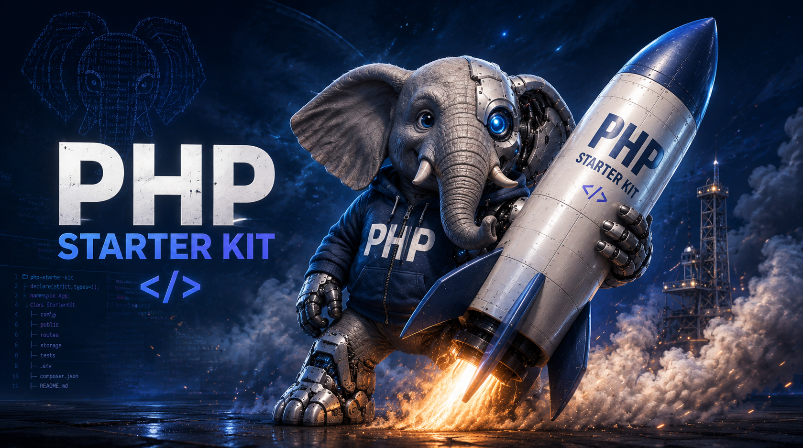
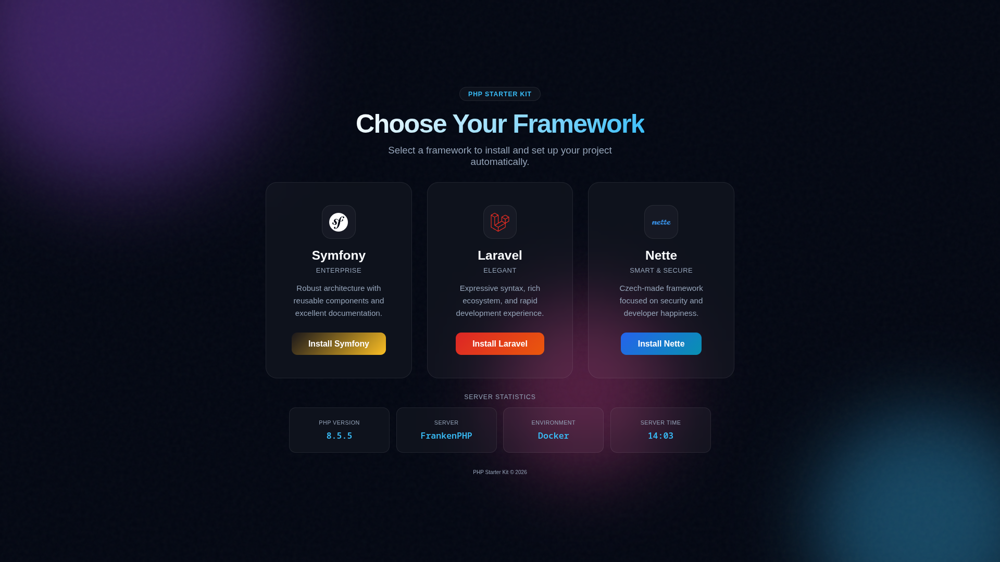
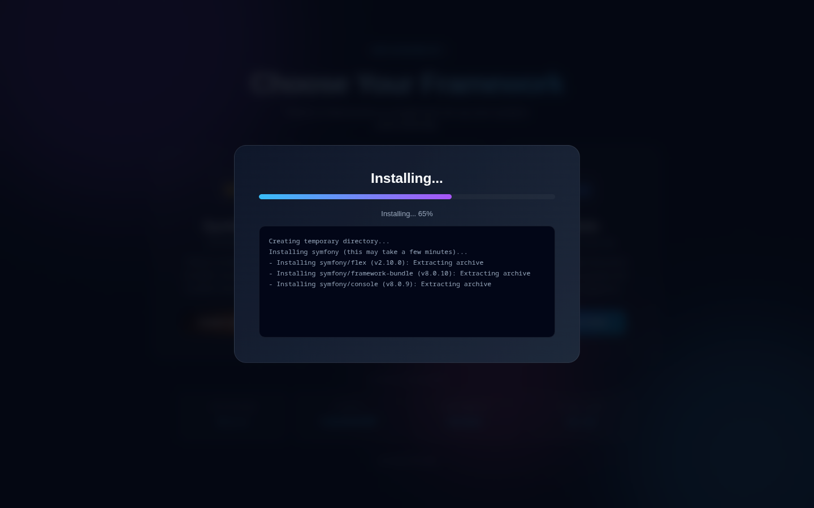
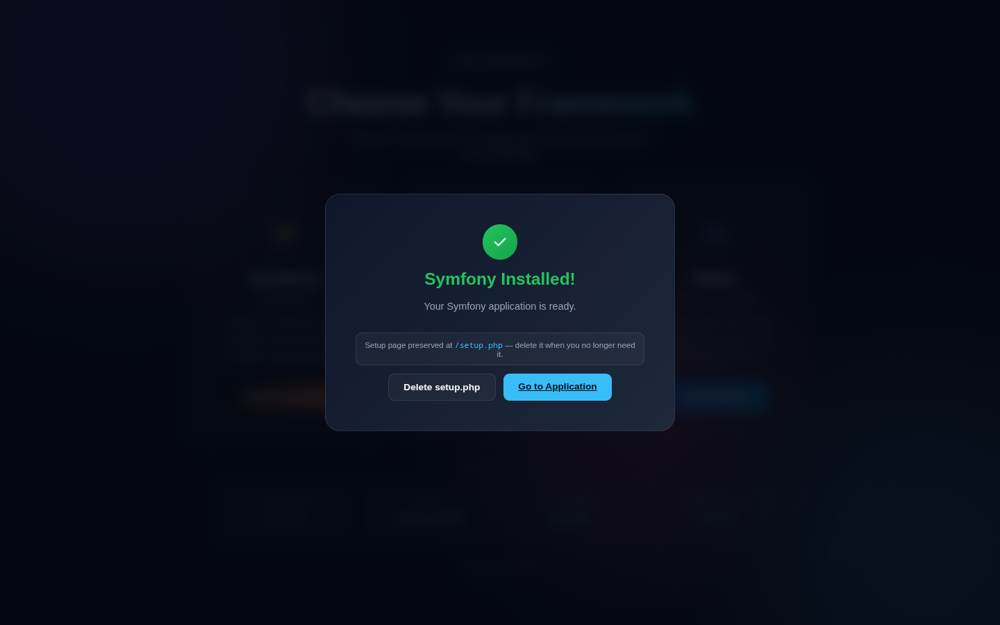

# PHP Starter Kit

Lightweight Docker-based template for PHP applications built on **FrankenPHP** — powered by shared base images and reusable workflows from **[rdurica/php-platform](https://github.com/rdurica/php-platform)**.

[](https://www.php.net/)
[](https://frankenphp.dev/)
[](https://github.com/rdurica/php-platform)
[](https://github.com/rdurica/php-starter-kit/actions)
[](LICENSE)

<!-- Placeholder images — replace docs/img/{main,1,2,3}.png with your own. -->


<p align="center">
  
  
  
</p>

## Table of Contents

- [Quick Start](#quick-start)
- [Architecture & Platform Updates](#architecture--platform-updates)
- [Overview](#overview)
- [Requirements](#requirements)
- [Available Commands](#available-commands)
- [Framework Installation](#framework-installation)
- [Environments](#environments)
- [Production](#production)
- [CI/CD](#cicd)
- [Related Repositories](#related-repositories)
- [License](#license)

## Quick Start

1. Click **Use this template** on GitHub to create your repository (GitHub Actions will automatically configure project placeholders in `.env.example`, `README.md`, and the setup wizard).
2. Clone your repository and initialize the environment:

```bash
git clone https://github.com/rdurica/php-starter-kit.git && cd php-starter-kit && make init
```

Then open [https://localhost](https://localhost) (auto-generated certificate) and select your framework from the setup wizard.

---

## Architecture & Platform Updates

Infrastructure (base Dockerfiles, Caddyfile, PHP INI, OPcache/JIT, entrypoint, and shared CI/build workflows) is maintained centrally in **[rdurica/php-platform](https://github.com/rdurica/php-platform)** instead of being duplicated across every project:

```text
  rdurica/php-platform (versioned releases: v1.0.1)
    ├── ghcr.io/rdurica/php-platform/{prod,ci,dev}:1.0.1   (base images)
    ├── .github/workflows/reusable-*.yaml                  (shared CI & build)
    └── renovate-preset.json                               (auto-update rules)
          │
          ▼  (consumed & kept in sync by Renovate PRs)
  your application repo (from php-starter-kit)
    ├── build/prod/Dockerfile                              (thin ~12-line image)
    ├── compose.yaml / compose.ci.yaml                     (pulls GHCR images)
    ├── .github/workflows/ci.yaml                          (customizable tests)
    └── renovate.json                                      (inherits preset)
```

| Responsibility | Where it lives | How updates propagate |
| --- | --- | --- |
| PHP / FrankenPHP runtime, extensions, Caddy, OPcache, entrypoint | [php-platform](https://github.com/rdurica/php-platform) | Renovate PR bumps `:1.x.y` tags in `Dockerfile` & `compose*.yaml` |
| Code quality & production Docker build workflows | [php-platform](https://github.com/rdurica/php-platform) | Renovate PR bumps `@v1.x.y` in caller workflows |
| Framework tests & app-specific CI steps | `.github/workflows/ci.yaml` (here) | Fully editable per application |
| Application code & dependencies (`src/`) | This repository | Owned by the application |

## Overview

This starter kit provides a fast, consistent local development and CI/production foundation for modern PHP projects without duplicating Docker or workflow boilerplate across repositories.

**Key aspects:**

- **Powered by [php-platform](https://github.com/rdurica/php-platform)** — Pulls prebuilt FrankenPHP 1.12 / PHP 8.5 images (`dev`, `ci`, `prod`) directly from GHCR
- **Automatic platform updates** — Preconfigured [renovate.json](renovate.json) inheriting the shared preset (auto-merge for patch/minor updates when CI passes)
- **Secure by default** — Non-root user, security headers, hardened sessions, no `expose_php`, Caddy admin disabled
- **Multi-stage production build** — Uses `php-platform/ci` for Composer and `php-platform/prod` for minimal runtime
- **Customizable CI/CD** — Shared quality & build workflows plus an editable `ci.yaml` for per-app tests
- **DevContainer support** — VSCode remote containers out of the box
- **One-click framework installer** — Web-based setup wizard for Laravel, Symfony, and Nette
- **Frontend ready** — Node.js and Vite integrated in the dev image

## Requirements

- [Docker](https://docs.docker.com/get-docker/) & Docker Compose
- [Make](https://www.gnu.org/software/make/) (optional but recommended)
- `sudo` access for trusting local HTTPS certificates

## Available Commands

Common development tasks are automated via `make`:

| Command | Description |
| --- | --- |
| `make init` | First-time setup: create `.env` from `.env.example`, network, pull images, start containers |
| `make update` | Pull updated platform images (`compose.yaml`) and recreate containers |
| `make up` | Start containers in detached mode |
| `make down` | Stop and remove containers |
| `make logs` | Show live logs from all containers |
| `make php` | Open shell inside the FrankenPHP container |
| `make rebuild` | Alias for `make update` |
| `make reload` | Recreate containers |
| `make setup-githooks` | Enable pre-commit hooks |
| `make trust-cert` | Trust Caddy's local CA certificate |

## Framework Installation

After running `make init`, open [https://localhost](https://localhost). The setup wizard will present three framework options:

| Framework | Description |
| --- | --- |
| **Symfony** | Robust architecture with reusable components |
| **Laravel** | Expressive syntax and rich ecosystem |
| **Nette** | Security-focused, Czech-made framework |

Click your chosen framework and confirm the installation. The wizard will:

1. Download and install the framework via Composer
2. Display real-time progress and terminal output
3. Move files into place automatically (including Nette's `www/` → `public/` migration)
4. Remove itself once the framework's own entry point takes over

After installation the setup wizard is gone and your application is served from `/`. From here the repository is yours — fill in the sections above and the placeholder screenshots in `docs/img/` with your own project content.

## Environments

### Development (`compose.yaml`)
- Uses `ghcr.io/rdurica/php-platform/dev` (Xdebug, Node.js, Git, Symfony CLI, Laravel installer)
- Caddy auto HTTPS on `https://localhost` with Vite HMR proxy
- Container name isolated per project via `COMPOSE_PROJECT_NAME` in `.env`

### CI (`compose.ci.yaml`)
- Uses `ghcr.io/rdurica/php-platform/ci` (no Xdebug, no Node.js)
- SQLite in-memory defaults for fast GitHub Actions runs without local Docker builds

## Production

Build the production image locally:

```bash
docker build -f build/prod/Dockerfile -t myapp:latest .
```

The production [Dockerfile](build/prod/Dockerfile) builds `vendor/` using `ghcr.io/rdurica/php-platform/ci` and copies only the application into `ghcr.io/rdurica/php-platform/prod`.

## CI/CD

Three GitHub Actions workflows are included:

| Workflow | Description |
| --- | --- |
| `code-quality.yml` | Calls `reusable-code-quality.yaml` (Compose config, PHPStan, PHP CS Fixer, Composer audit, Frontend lint) |
| `ci.yaml` | Calls `reusable-ci-checks.yaml` and runs customizable framework tests (`Framework Tests`) |
| `build.yaml` | Calls `reusable-build.yaml` (multi-stage prod image build, GHCR push, Trivy security scan) |

## Related Repositories

- **[rdurica/php-platform](https://github.com/rdurica/php-platform)** — Shared FrankenPHP/PHP Docker base images, GitHub Reusable Workflows, and Renovate preset.
- **[rdurica/php_starter_kit](https://github.com/rdurica/php_starter_kit)** — Legacy monolithic starter kit (unsupported).

## License

This project is licensed under the terms of the [MIT license](LICENSE).
